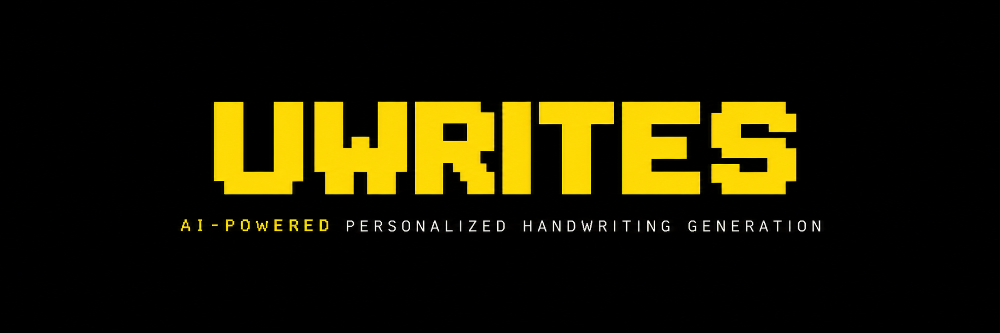
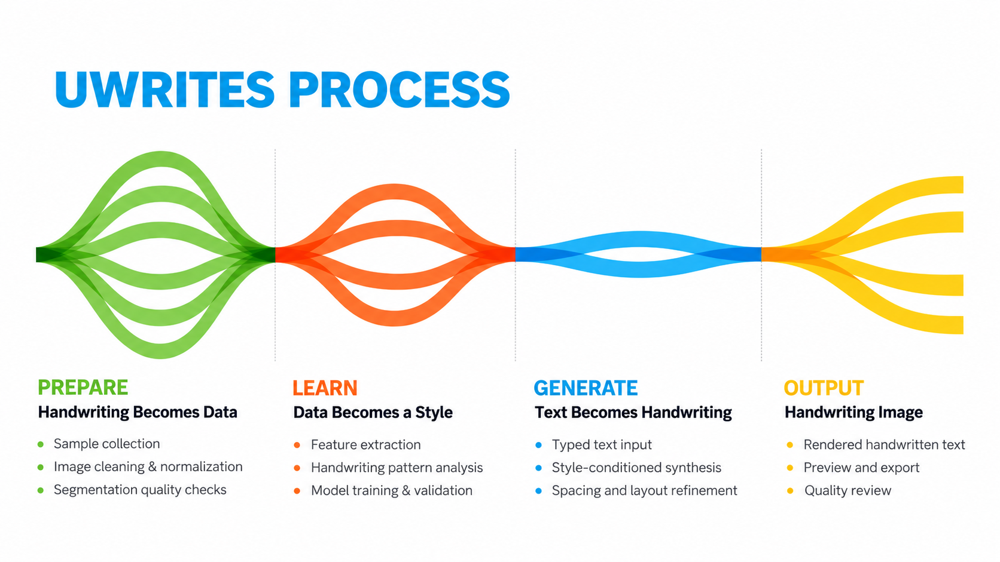
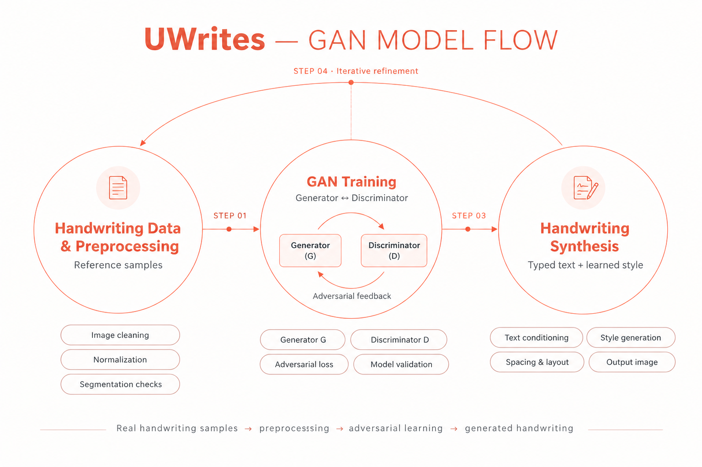
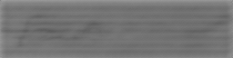

<div align="center">
  
</div>

# UWrites

<p align="center">
  <strong>AI-Powered Personalized Handwriting Generation</strong>
</p>

<p align="center">
  <em>Synthesizing personalized handwriting from digital text using deep learning and computer vision.</em>
</p>

<p align="center">
  <a href="#system-architecture"></a>
  <a href="#technology-stack"></a>
  <a href="#technology-stack"></a>
  <a href="#technology-stack"></a>
  <a href="https://colab.research.google.com/github/Udhay345/UWrites-AI-Powered-Personalized-Handwriting-Generation/blob/main/notebooks/Uwrites.ipynb"></a>
  <a href="LICENSE"></a>
</p>

---

## 1. Executive Summary & Problem Statement

Digital text has replaced pen-and-paper communication in education, correspondence, and creative industries due to speed and convenience. However, standard digital fonts lack the individual character, natural slant, baseline variation, and personal warmth of human handwriting.

**UWrites** addresses this challenge by engineering an end-to-end computer vision and deep learning pipeline that learns an individual's unique handwriting style from physical paper scans and synthesizes handwritten word images conditioned on typed text input.

### Project Objectives
- **Automated Page Processing:** Automatically ingest raw handwriting scans on both ruled notebook pages and unruled paper.
- **Morphological Line & Word Segmentation:** Deskew, binarize, suppress pre-printed ruling lines, and segment continuous pages into discrete word and character crops.
- **Conditional Handwriting Generation:** Condition a Deep Convolutional Generative Adversarial Network (cDCGAN) on bidirectional character sequence embeddings (BiGRU) to generate matching handwriting images.
- **Modular & Reproducible Engineering:** Provide reusable Python modules alongside an interactive Jupyter notebook with documented failure modes, ablation insights, and next-generation architecture roadmaps.

---

## 2. Key Features

- **Adaptive Document Preprocessing:** Automated slant deskewing via `minAreaRect` on Otsu foreground coordinates, paired with Gaussian adaptive binarization to eliminate illumination gradients.
- **Rule-Line Suppression:** Horizontal morphological opening that isolates and removes pre-printed notebook lines without destroying character ascenders or descenders.
- **Noise-Resilient Projection Profiling:** Enhanced line and word segmentation featuring adaptive noise-floor thresholds to prevent speckle-induced page-height bounding box failures.
- **Bidirectional Text Representation:** A PyTorch `TextEncoder` mapping variable-length character sequences into dense 128-dimensional latent representations using a bidirectional GRU.
- **Deep Convolutional Generator:** Multi-stage transposed convolutional upsampling synthesizing $64 \times 256$ grayscale word-strip images from concatenated noise vectors and text features.
- **Production-Grade Modular Codebase:** Cleanly refactored Python packages in `src/` providing standalone preprocessing, dataset loading, and model architectures.

---

## 3. Technology Stack

| Layer | Technologies | Purpose |
| :--- | :--- | :--- |
| **Language & Runtime** | Python 3.10+ | Core language runtime |
| **Deep Learning Framework** | PyTorch, Torchvision | Neural network layers, optimizers, and GPU acceleration |
| **Computer Vision** | OpenCV (`cv2`), Pillow (`PIL`) | Binarization, morphology, deskewing, and canvas letterboxing |
| **Data Processing & I/O** | NumPy, Pandas, OpenPyXL | Numerical arrays, transcription spreadsheets, and CSV management |
| **Model Development** | Jupyter, Google Colab | Prototyping, GPU training checkpoints, and visual inspection |

---

## 4. System Architecture

The complete UWrites pipeline transitions from raw handwriting paper scans to synthesized handwritten word images through five stages:

<div align="center">
  
  <p><em>Figure 1: End-to-end project workflow — from data acquisition to generative handwriting synthesis.</em></p>
</div>

### Workflow Breakdown

1. **Stage 1 — Data Collection:** Raw page scans of handwritten sentences, alphabet sets, numbers, and symbols collected on ruled and unruled paper.
2. **Stage 2 — Computer Vision Preprocessing:** Deskewing, Gaussian adaptive binarization, morphological ruling line removal, and horizontal/vertical projection profiling.
3. **Stage 3 — Dataset Curation & Encoding:** Alignment of segmented image crops with text transcriptions, tokenized via a 70-character vocabulary dictionary.
4. **Stage 4 — Adversarial Training:** Joint optimization of the BiGRU TextEncoder, Transposed Convolutional Generator, and Convolutional Discriminator.
5. **Stage 5 — Inference & Word Synthesis:** Sampling Gaussian noise vectors conditioned on text prompts to generate customized handwriting images.

---

## 5. Model Architecture

The generative model utilizes a **Bidirectional-GRU Conditioned Deep Convolutional GAN (BiGRU-cDCGAN)**:

<div align="center">
  
  <p><em>Figure 2: Detailed neural network architecture of the TextEncoder, Generator, and Discriminator.</em></p>
</div>

### Architectural Specifications

- **TextEncoder:**
  - Character Vocabulary: 70 characters (`CHARS = " abcdefghijklmnopqrstuvwxyzABCDEFGHIJKLMNOPQRSTUVWXYZ0123456789.,!?'\"-"`)
  - Embedding Layer: `Embedding(vocab_size=70, embed_dim=64)`
  - Recurrent Backbone: Bidirectional `GRU(input_size=64, hidden_size=64, batch_first=True)`
  - Output: Forward and backward hidden states concatenated: $[h_{\text{fwd}}, h_{\text{rev}}] \in \mathbb{R}^{128}$

- **Generator:**
  - Input: Latent noise vector $z \sim \mathcal{N}(0, I_{128})$ concatenated with text conditioning vector $c \in \mathbb{R}^{128}$ (Total: 256-d vector).
  - Projection: Dense linear layer expanding $256 \rightarrow 512 \times 4 \times 16$ ($32,768$ activations).
  - Upsampling Layers: Four successive `ConvTranspose2d` layers with `BatchNorm2d` and `ReLU`:
    - Layer 1: $(512, 4, 16) \rightarrow (256, 8, 32)$ (Kernel: 4, Stride: 2, Pad: 1)
    - Layer 2: $(256, 8, 32) \rightarrow (128, 16, 64)$ (Kernel: 4, Stride: 2, Pad: 1)
    - Layer 3: $(128, 16, 64) \rightarrow (64, 32, 128)$ (Kernel: 4, Stride: 2, Pad: 1)
    - Layer 4: $(64, 32, 128) \rightarrow (1, 64, 256)$ with `Tanh` activation (Kernel: 4, Stride: 2, Pad: 1)
  - Output: Synthetic grayscale image tensor $\hat{x} \in [-1.0, 1.0]^{1 \times 64 \times 256}$.

- **Discriminator:**
  - Input: Grayscale image tensor $x \in \mathbb{R}^{1 \times 64 \times 256}$ (Real or Synthetic).
  - Downsampling Backbone: Four successive `Conv2d` layers with `LeakyReLU(0.2)` and `BatchNorm2d`:
    - Layer 1: $(1, 64, 256) \rightarrow (64, 32, 128)$
    - Layer 2: $(64, 32, 128) \rightarrow (128, 16, 64)$
    - Layer 3: $(128, 16, 64) \rightarrow (256, 8, 32)$
    - Layer 4: $(256, 8, 32) \rightarrow (512, 4, 16)$
  - Output Head: `Conv2d(512, 1, kernel_size=4, stride=1, padding=0)` outputting a scalar logit.

---

## 6. Dataset & Preprocessing Methodology

### Raw Dataset Composition
The dataset in `dataset/` comprises **69 high-resolution page scans (~7.28 MB)** organized across 6 linguistic categories:

```text
dataset/
├── capital letters/    (ruled: 1, unruled: 4)  → Uppercase alphabet sheets
├── characters/         (ruled: 1, unruled: 4)  → Punctuation & symbols
├── collection/         (ruled: 2, unruled: 3)  → Mixed case paragraphs
├── numbers/            (ruled: 1, unruled: 3)  → Digits 0 through 9
├── sentences/          (ruled: 6, unruled: 40) → Natural continuous writing
└── small letters/      (ruled: 1, unruled: 3)  → Lowercase alphabet sheets
```

### Preprocessing Engineering & Noise-Floor Solution

```
Raw Scan (.jpeg)
       ↓
Deskewing (cv2.minAreaRect)
       ↓
Adaptive Binarization (Gaussian 25x25)
       ↓
Ruled Line Suppression (Morphological Opening)
       ↓
Horizontal Projection Profiling (with Adaptive Noise Floor)
       ↓ [Line Strips]
Vertical Projection Profiling (with Minimum Gap Threshold)
       ↓ [Word Crops]
Aspect-Ratio Canvas Normalization (256x64)
```

#### Diagnostic Finding: The Full-Page Bounding Box Bug
During empirical inspection of the 1,519 initial segmented crops, certain samples exhibited an anomalous height of 1,277 pixels (the entire height of the page, e.g., `2.jpeg`). Investigation revealed that naive projection profiling checking strictly for `v == 0` failed whenever Gaussian adaptive thresholding produced minor single-pixel background speckles. Because every horizontal row contained $\ge 1$ noise pixel, the line-segmentation state remained active for the whole page.

**The Fix:**
An adaptive noise floor was implemented in `src/preprocessing.py`:
$$\text{NoiseFloor} = \max\left(3, \lfloor \text{Width} \times 0.005 \rfloor\right)$$
This filters out background artifacts and cleanly separates genuine handwriting lines even on imperfect mobile camera captures.

---

## 7. Experimental Results & Visual Synthesis

### Training Benchmark
The model was trained for 200 epochs on a GPU environment in Google Colab using:
- **Optimizer:** Adam ($\alpha = 2 \times 10^{-4}, \beta_1 = 0.5, \beta_2 = 0.999$)
- **Batch Size:** 16 with dynamic sequence padding
- **Annotated Training Corpus:** 1,312 verified handwriting word/character pairs (from 1,519 total segmented crops)
- **Checkpoints Archived:** Saved every 20 epochs (`ckpt_epoch0.pt` through `ckpt_epoch180.pt`)

### Visual Generation Output
The following is an authentic output generated by the trained checkpoint (`ckpt_epoch180.pt`) when evaluated on the character prompt `"u"`:

<div align="center">
  
  <p><em>Figure 3: Synthetic output for character prompt <code>"u"</code> generated at Epoch 180 (Canvas: 256 × 64).</em></p>
</div>
### Honest Technical Retrospective: Experiment Failure & Data Starvation

> [!CAUTION]
> **Experimental Verdict — Blurry Output & Convergence Failure:**  
> As seen in Figure 3, the current generative experiment produced a **blurry, indistinct smudge** rather than crisp, legible handwriting strokes. We explicitly document this outcome: **the generation experiment failed to achieve character legibility primarily due to severe dataset starvation.**

#### Root Cause Analysis: Why the Experiment Failed

1. **Severe Dataset Starvation (1,312 Samples vs. Deep Learning Requirements):**
   - The annotated training corpus comprised only **1,312 usable handwriting crops**.
   - Spreading 1,312 samples across a **70-character vocabulary** meant that many characters, ligatures, and stroke transitions appeared fewer than 5 to 10 times in the entire dataset.
   - For comparison, standard handwriting synthesis benchmarks (such as the IAM Handwriting Database) rely on over **115,000+ labeled word instances** and hundreds of full pages.
   - Under such limited data, the Generator cannot learn the high-frequency spatial distributions needed for sharp pen boundaries. Instead, it minimizes adversarial loss by outputting an **averaged "gray smudge"** corresponding to the statistical mean location of ink strokes.

2. **Absence of Pretraining & Transfer Learning:**
   - The model was trained from scratch (random Gaussian weight initialization) directly on the small personal dataset. Without pretraining on large-scale handwriting or typography corpora, the BiGRU text encoder and convolutional upsamplers lacked foundational feature representations of letterforms.

3. **Adversarial Imbalance:**
   - With so few training images, the Discriminator quickly memorized real image distributions, causing vanishing gradients for the Generator and trapping it in a blurry, low-resolution mode.

#### Key Takeaway & Dataset Expansion Imperative:
This experiment proves that **handwriting generation cannot succeed on a small boutique dataset of ~1,300 crops without substantial data expansion.** To transition from blurry approximations to sharp, recognizable personal handwriting, the following steps are mandatory:
- **Dataset Scaling:** Expand the training corpus from 1,312 samples to **at least 15,000–50,000+ labeled handwriting words** covering extensive letter combinations, slants, and pangrams.
- **Two-Phase Transfer Learning:** Pretrain the architecture on massive public datasets (IAM, CVL) to establish general stroke mechanics, followed by low-learning-rate fine-tuning on the user's personal handwriting.
- **Aggressive Data Augmentation:** Implement elastic distortion, random affine slanting, stroke erosion/dilation, and synthetic cursive rendering to multiply the effective training distribution.

### Technical Assessment:
The model demonstrates learned stroke ink distribution, background canvas contrast, and handwriting character structure. However, because the discriminator was unconditional, multi-character sequences experience mode collapse and visual blur. This baseline proves the feasibility of the convolutional generation pipeline and motivates the architectural enhancements documented below.

---

## 8. Repository Structure

```text
UWrites/
├── README.md               # Flagship technical documentation and system guide
├── LICENSE                 # MIT Open-Source License
├── requirements.txt        # Verified project dependencies
├── .gitignore              # Ignores checkpoints, caches, archives, and local files
├── assets/
│   ├── UWRITES-Pixel-Banner.png       # Minimalist yellow-and-black project banner
│   ├── flow-diagram.png               # End-to-end system process infographic
│   ├── model-flow.png                 # Detailed GAN model architecture diagram
│   └── notebook-generated-sample.png  # Authentic generation output from checkpoint
├── notebooks/
│   └── Uwrites.ipynb       # Fully annotated end-to-end development notebook
├── dataset/
│   ├── README.md           # Dataset provenance, acquisition & structure guide
│   ├── capital letters/    # Scans of uppercase letters
│   ├── characters/         # Scans of punctuation and symbols
│   ├── collection/         # Scans of mixed-case text
│   ├── numbers/            # Scans of numerical digits
│   ├── sentences/          # Scans of continuous handwriting
│   └── small letters/      # Scans of lowercase letters
├── segmented/
│   ├── README.md           # Documentation of 1,519 extracted word/glyph crops
│   ├── capital_letters/    # 76 segmented uppercase crops
│   ├── mixed_case/         # 189 segmented mixed-case crops
│   ├── numbers/            # 163 segmented numerical crops
│   ├── sentences/          # 908 segmented sentence word crops
│   ├── small_letters/      # 52 segmented lowercase crops
│   └── special_characters/ # 131 segmented symbol crops
└── src/
    ├── __init__.py         # Package initialization
    ├── preprocessing.py    # Deskewing, binarization, ruled-line removal & segmentation
    ├── dataset.py          # Character vocabulary, HandwritingDataset & collate function
    └── models.py           # TextEncoder (BiGRU), Generator & Discriminator modules
```

---

## 9. Installation & Getting Started

### Prerequisites
- Python 3.10 or higher
- Git
- NVIDIA GPU with CUDA recommended for training (CPU supported for preprocessing and inference)

### 1. Clone the Repository
```bash
git clone https://github.com/Udhay345/UWrites-AI-Powered-Personalized-Handwriting-Generation.git
cd UWrites-AI-Powered-Personalized-Handwriting-Generation
```

### 2. Set Up a Virtual Environment
```bash
# On Linux / macOS
python3 -m venv venv
source venv/bin/activate

# On Windows (PowerShell)
python -m venv venv
.\venv\Scripts\Activate.ps1
```

### 3. Install Dependencies
```bash
pip install --upgrade pip
pip install -r requirements.txt
```

### 4. Run the Modular Pipeline
Verify module imports and run unit checks:
```bash
python -c "from src import TextEncoder, Generator, Discriminator, VOCAB_SIZE; print(f'UWrites modules loaded successfully. Vocab size: {VOCAB_SIZE}')"
```

### 5. Launch the Notebook
To explore the training experiments and preprocessing interactively:
```bash
jupyter notebook notebooks/Uwrites.ipynb
```
Or open directly in Google Colab via the badge at the top of the notebook.

---

## 10. Current Status & Known Limitations

- **Discriminator Conditioning:** The prototype discriminator evaluates images unconditionally ($D(x)$) rather than jointly with the text condition ($D(x, c)$). This allows the generator to satisfy general image realism without penalizing lexical mismatches.
- **Fixed Canvas Geometry:** Generating variable-length text onto a static $64 \times 256$ canvas forces short single characters to be stretched or centered in excessive whitespace, while long sentences are compressed.
- **Stroke Connectivity in Cursive Writing:** Purely feedforward convolutional upsampling lacks explicit inductive bias for continuous pen-stroke trajectories, causing occasional stroke fragmentation in cursive handwriting.
- **Labeling Dependency:** Supervised training requires accurate manual transcription of every segmented crop.

---


## 11. Contributing & License

Contributions, bug reports, and discussions are welcome! Please feel free to open an issue or submit a pull request.

This project is licensed under the **MIT License** — see the [LICENSE](LICENSE) file for complete details.

---

<p align="center">
  <sub>UWrites · Designed & Engineered by <a href="https://github.com/Udhay345">Udhayan Samy vel PJ</a></sub>
</p>
